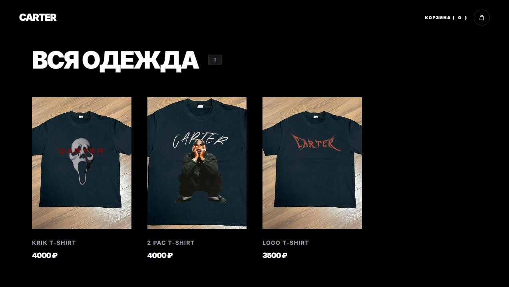
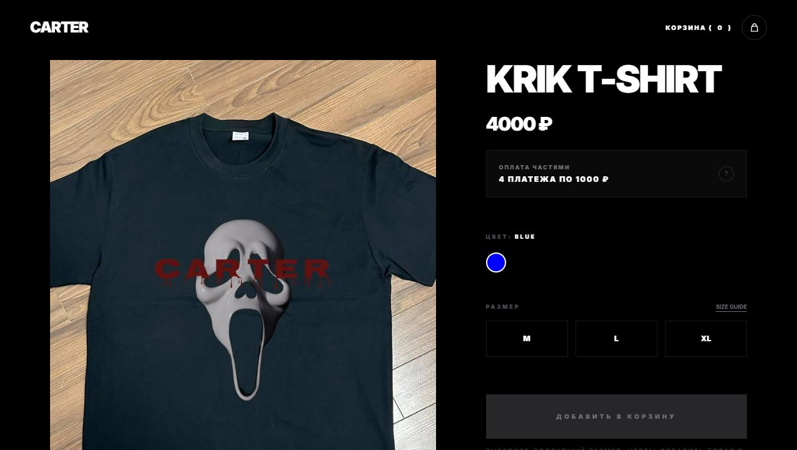
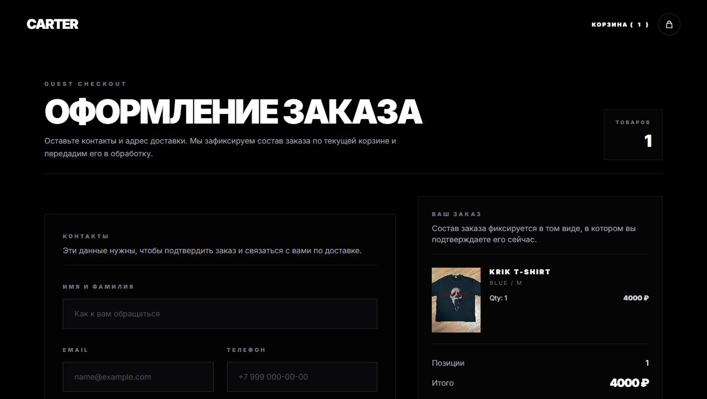
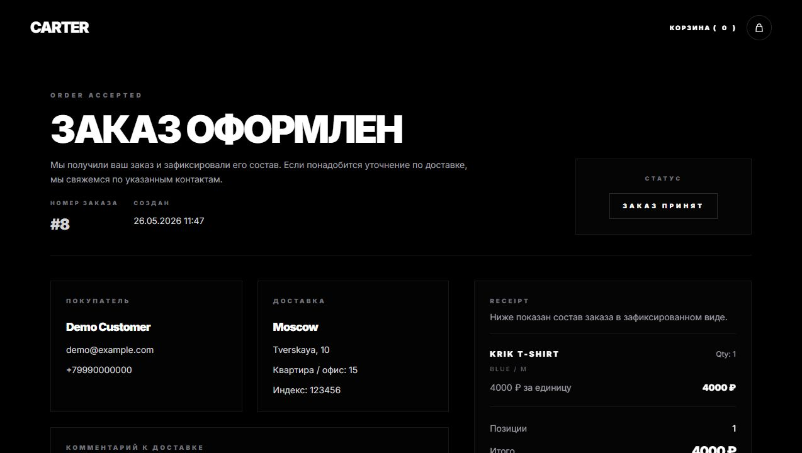
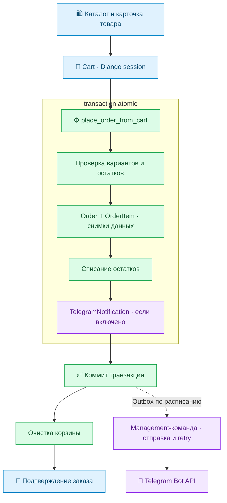

<h1 align="center">🛍️ CARTER CLOTHING</h1>

<p align="center">
  <strong>Магазин одежды на Django — от выбора размера до оформленного заказа</strong>
</p>

<p align="center">
  Каталог с вариантами товаров · Корзина без регистрации · Транзакционный checkout · Telegram-уведомления
</p>

<p align="center">
  
  =5.1,<6.0">
  
  
  
</p>

<p align="center">
  <a href="#preview">Интерфейс</a> ·
  <a href="#features">Возможности</a> ·
  <a href="#engineering">Под капотом</a> ·
  <a href="#quick-start">Запуск</a> ·
  <a href="#tests">Тесты</a>
</p>

---

Carter — мой pet-проект интернет-магазина одежды. Покупатель выбирает цвет и размер, собирает корзину и оформляет заказ без аккаунта. Менеджер управляет ассортиментом и заказами через Django Admin и может получать уведомления в Telegram.

В проекте я работаю с практическими задачами backend-разработки: моделированием товарных вариантов, актуальностью остатков, согласованностью данных при checkout и отправкой уведомлений отдельно от HTTP-запроса покупателя.

<a id="preview"></a>

## ✨ Интерфейс

**Каталог** — тёмная витрина с крупными фотографиями и акцентом на товар.



<table>
  <tr>
    <td width="50%" align="center"><strong>🎨 Карточка товара</strong><br>Галерея, цвет, размер и наличие</td>
    <td width="50%" align="center"><strong>🛒 Оформление заказа</strong><br>Контакты, адрес и состав покупки</td>
  </tr>
  <tr>
    <td></td>
    <td></td>
  </tr>
</table>

<details>
<summary>🧾 Подтверждение заказа</summary>



Состав и стоимость заказа отображаются из сохранённых данных покупки.

</details>

<a id="features"></a>

## 🧩 Возможности

| Для покупателя | Для менеджера |
| --- | --- |
| Каталог с фотографиями и ценами | Управление товарами и порядком их показа |
| Галерея и выбор сочетания цвета и размера | Варианты товара с отдельными остатками |
| Боковая корзина и отдельная страница корзины | Управление изображениями, цветами и размерами |
| Изменение количества через AJAX | Просмотр заказов и их позиций в админке |
| Заказ без регистрации и подтверждение покупки | Telegram-уведомления и просмотр ошибок отправки |

**Путь покупателя:** каталог → товар → цвет и размер → корзина → контактные данные и адрес → подтверждение заказа.

<a id="engineering"></a>

## ⚙️ Под капотом

### 📦 Остатки на уровне варианта товара

`ProductVariant` связывает товар, цвет, размер и остаток. Уникальность этой комбинации закреплена в базе данных. Изображения можно привязать к цвету, а порядок товаров и фотографий — настроить вручную.

↳ [Модель каталога](shop/models.py)

### 🛒 Корзина, которая учитывает изменения каталога

В Django session хранятся идентификаторы вариантов и количество. При чтении корзина сверяется с актуальными данными: удаляет некорректные и недоступные позиции, ограничивает количество остатком и пересчитывает сумму. Изменение количества возвращает JSON для обновления интерфейса без перезагрузки страницы.

↳ [Логика корзины](cart/cart.py) · [HTTP-обработчики](cart/views.py)

### 🔐 Оформление заказа в одной транзакции

Сервис `place_order_from_cart` повторно проверяет варианты и остатки, создаёт заказ и его позиции, списывает товар и добавляет уведомления в outbox внутри `transaction.atomic()`. Очистка корзины зарегистрирована через `transaction.on_commit()` и выполняется после успешного коммита.

В коде используется `select_for_update()`; блокировка строк действует на поддерживающих её СУБД. В текущей конфигурации с SQLite этот вызов не блокирует строки — [особенность Django и SQLite](https://docs.djangoproject.com/en/5.2/ref/databases/#queryset-select-for-update-not-supported).

↳ [Сервис оформления заказа](orders/services.py)

### 🧾 История покупки сохраняется отдельно от каталога

`OrderItem` хранит снимки названия, цвета, размера, цены и суммы позиции. Последующее редактирование карточки товара не меняет сохранённые данные заказа и его подтверждение.

↳ [Модели заказов](orders/models.py) · [Страница подтверждения](orders/views.py)

### 📨 Уведомления через database outbox

При включённой интеграции checkout создаёт `TelegramNotification` для каждого настроенного чата. Отдельная management-команда отправляет уведомления, фиксирует результат и назначает повторную попытку при ошибке. HTTP-запрос покупателя не ждёт ответа Telegram.

↳ [Обработчик outbox](orders/management/commands/process_telegram_notifications.py) · [Telegram gateway](orders/telegram_gateway.py)

## 🗺️ Архитектура



## 🛠️ Технологии

| Слой | Инструменты и роль |
| --- | --- |
| Backend | **Python, Django ≥5.1 и <6.0** — views, формы, ORM, транзакции и админка |
| Интерфейс | **Django Templates, Tailwind CSS через CDN, JavaScript** — серверные страницы и AJAX-корзина |
| Данные | **SQLite** в текущих настройках; сессии и outbox в базе данных |
| Изображения | **Pillow, Django ImageField** — фотографии товаров |
| Интеграция | **Telegram Bot API** — уведомления менеджеру |
| Проверки | **Django TestCase / TransactionTestCase, unittest.mock** — бизнес-логика, HTTP-сценарии и внешние вызовы |
| Конфигурация | **python-decouple**, отдельные настройки `dev` и `test` |

<a id="quick-start"></a>

## 🚀 Локальный запуск

Понадобятся Git и Python с `venv` и `pip`, совместимый с зависимостями из [requirements.txt](requirements.txt).

**1. Склонируйте репозиторий и установите зависимости.**

```bash
git clone https://github.com/FrankHeels/carter.git
cd carter
```

<details open>
<summary>🐧 macOS / Linux</summary>

```bash
python3 -m venv .venv
source .venv/bin/activate
python -m pip install -r requirements.txt
cp .env.example .env
```

</details>

<details>
<summary>🪟 Windows PowerShell</summary>

```powershell
python -m venv .venv
.\.venv\Scripts\Activate.ps1
python -m pip install -r requirements.txt
Copy-Item .env.example .env
```

</details>

**2. Настройте `.env`.** Замените значение `SECRET_KEY` собственным случайным ключом. Для запуска без Telegram установите:

```dotenv
TELEGRAM_NOTIFICATIONS_ENABLED=False
```

В `.env.example` интеграция включена с демонстрационными реквизитами, поэтому этот параметр нужно изменить. `DEBUG=True` и локальные `ALLOWED_HOSTS` из примера подходят для разработки.

**3. Создайте базу, администратора и запустите приложение.** В активированном виртуальном окружении:

```bash
python manage.py migrate
python manage.py createsuperuser
python manage.py runserver
```

- Магазин: [localhost:8000](http://127.0.0.1:8000/)
- Админка: [localhost:8000/admin](http://127.0.0.1:8000/admin/)

После миграций каталог пуст. В админке добавьте категории, цвета и размеры, затем товары, изображения и варианты с `stock > 0`. Скриншоты выше показывают пример заполненного магазина.

<details>
<summary>📨 Подключение Telegram-уведомлений</summary>

Укажите в `.env` токен своего бота и идентификаторы чатов менеджеров через запятую:

```dotenv
TELEGRAM_NOTIFICATIONS_ENABLED=True
TELEGRAM_BOT_TOKEN=your-bot-token
TELEGRAM_MANAGER_CHAT_IDS=123456789,987654321
TELEGRAM_NOTIFICATION_RETRY_MINUTES=10
```

В активированном виртуальном окружении выполните:

```bash
python manage.py process_telegram_notifications
```

Команда обрабатывает записи, у которых наступило время отправки, и завершает работу. Для регулярной обработки её нужно запускать по расписанию, например через cron. Интервал в настройках применяется и к первой отправке, и к повторным попыткам: при значении `10` новый заказ попадёт в обработку не раньше чем через 10 минут.

Outbox хранит отдельную запись для каждой пары «заказ — чат». Успешно отмеченные записи повторно не выбираются; при неоднозначном сетевом сбое повторная доставка сообщения возможна.

</details>

<a id="tests"></a>

## 🧪 Что проверяют тесты

| Область | Сценарии |
| --- | --- |
| Корзина | Добавление, изменение количества, удаление, очистка, некорректные данные сессии и ограничения по остаткам |
| HTTP-обработчики | POST-операции с корзиной, AJAX-ответы, валидация checkout и редиректы |
| Заказ | Создание позиций, списание остатков, очистка корзины после коммита, отклонение некорректной корзины |
| Снимки данных | Сохранность названия, цвета, размера и цены после изменений каталога |
| Telegram outbox | Постановка в очередь, формат сообщения, отправка, повторные попытки и пропуск записей со статусом `SENT` |
| Подтверждение | Доступ через одноразовый `last_order_id` в сессии и отображение сохранённых данных |

В активированном виртуальном окружении:

```bash
python manage.py check --settings=config.settings.test
python manage.py test cart.tests orders.tests --settings=config.settings.test
```

Тестовые настройки не читают локальный `.env`; вызовы Telegram в тестах подменяются mock-объектами.

↳ [Тесты корзины](cart/tests.py) · [Тесты заказов и уведомлений](orders/tests.py)

<details>
<summary>📁 Структура проекта и текущий объём реализации</summary>

```text
carter/
├── shop/       # Каталог, варианты, изображения и страницы товаров
├── cart/       # Сессионная корзина, HTTP-операции и AJAX
├── orders/     # Checkout, снимки заказа, outbox и Telegram gateway
├── config/     # Настройки dev/test, маршруты, ASGI и WSGI
└── readme/     # Скриншоты интерфейса
```

Реализован сценарий выбора товара и оформления заказа. Онлайн-оплата пока не подключена к checkout: файлы `orders/payments/` содержат отдельные заготовки интеграции. Локальный запуск использует SQLite и Django development server.

</details>

---

## 👨‍💻 Автор

**Nikolai · Python Backend Developer**

<p>
  <a href="https://github.com/FrankHeels">
    
  </a>
  <a href="https://t.me/FrankHeels">
    
  </a>
  <a href="mailto:lock.your.mean@gmail.com">
    
  </a>
</p>
